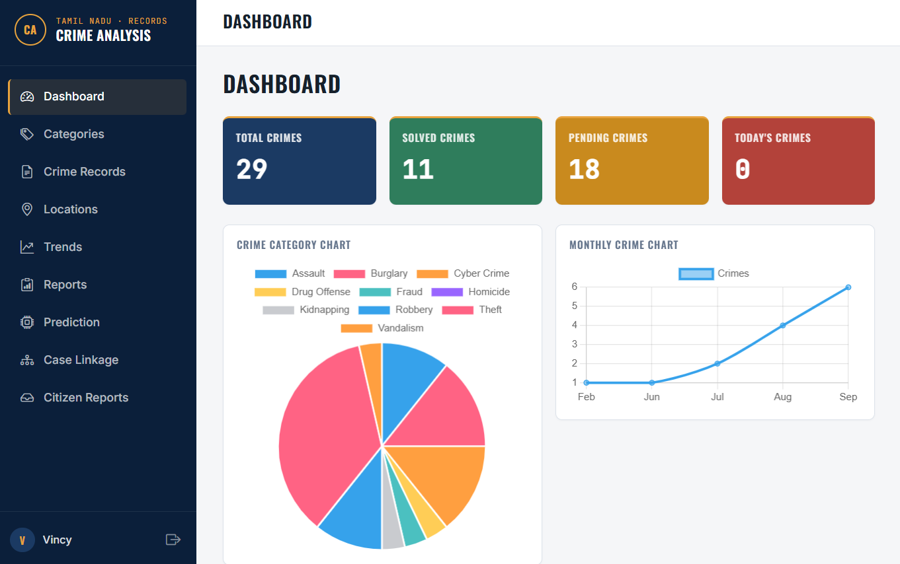
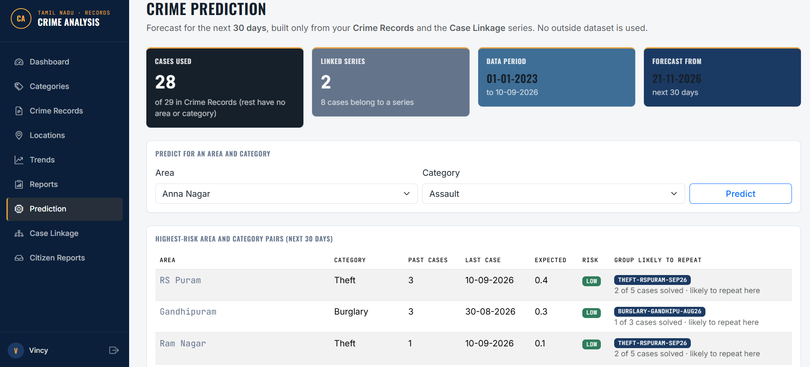
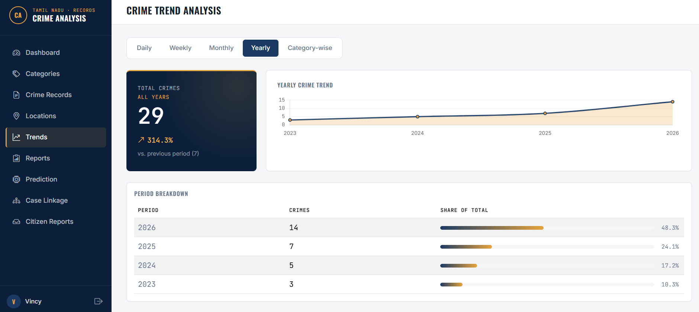

# Crime Analysis Dashboard

A web-based crime analysis system for Tamil Nadu records, built with Flask and MySQL. It helps analysts manage crime records, spot linked cases, view trends, and forecast where crime is likely to repeat.

## Features

- **Dashboard:** summary of crimes, statuses and recent cases.
- **Crime Records:** add, edit, delete, search and filter cases by status and category.
- **Categories and Locations:** manage crime categories and areas.
- **Trends:** daily, weekly and monthly crime trend charts.
- **Reports:** filtered reports with CSV export.
- **Case Linkage:** automatically groups similar cases (same category, nearby, close in time) into crime series. Each series gets a generated group name such as `THEFT-RAMNAGAR-SEP26`, shows how many of its cases are solved, and has a forecast of its likely next areas and date.
- **Prediction:** estimates the expected number of crimes in the next 30 days for each area and category. It uses only the cases in Crime Records plus the Case Linkage series, shows the linked group likely to repeat, and includes a backtest so the accuracy is visible.
- **Citizen Portal:** the public can report incidents and track the status of a report.
- **Login:** staff authentication.

All dates are displayed and entered as **DD-MM-YYYY**. The database stores them as `YYYY-MM-DD`.

## Screenshots

### Dashboard


### Crime Records


### Case Linkage


### Prediction


### Trends


## Tech Stack

Python, Flask, MySQL (PyMySQL), Jinja2, Bootstrap and JavaScript charts.

## Setup

1. Clone the repository.
   ```bash
   git clone https://github.com/vincynigidha/crime-analysis-dashboard.git
   cd crime-analysis-dashboard
   ```
2. Install the dependencies.
   ```bash
   pip install -r requirements.txt
   ```
3. Create the database and tables by running `schema.sql` in MySQL.
4. Set the environment variables in PowerShell. The app reads the MySQL password and secret key from these, so no password is stored in the code.
   ```powershell
   $env:DB_PASSWORD = "your-mysql-password"
   $env:SECRET_KEY = "any-long-random-text"
   ```
   These last only for the current terminal. To save them permanently, run the commands below once, then close and reopen the terminal or VS Code:
   ```powershell
   setx DB_PASSWORD "your-mysql-password"
   setx SECRET_KEY "any-long-random-text"
   ```
   Optional: `DB_HOST`, `DB_USER` and `DB_NAME` (defaults are `localhost`, `root` and `crime_analysis`).
5. Create the first admin login (one time).
   ```bash
   python create_admin.py
   ```
6. Run the app from the folder that contains `app.py`.
   ```bash
   python app.py
   ```
7. Open http://127.0.0.1:5000 and log in.

## Troubleshooting

- **`Access denied for user 'root'@'localhost' (using password: NO)`:** the app did not get your password. Set `DB_PASSWORD` in the same terminal where you run `python app.py`, or use `setx` and reopen the terminal.
- **`can't open file 'app.py'`:** you are in the wrong folder. Use `cd` to go into the folder that contains `app.py`.
- **`Can't connect to MySQL server`:** start MySQL first.
- **`Unknown database 'crime_analysis'`:** run `schema.sql` first.
- **`No module named ...`:** run `pip install -r requirements.txt`.

## How the Prediction Works

- For each area and category pair, recent cases count more than old ones (a case's weight halves every 30 days).
- If Case Linkage finds an active series likely to strike that area again, the series' own pace is used when it is higher.
- A backtest compares what the model would have predicted 30 days ago with what actually happened.
- With a small number of records the numbers are rough planning estimates. They improve as more records are added.

## Project Structure

```
app.py            Flask routes and logic
db.py             MySQL connection (reads credentials from environment variables)
create_admin.py   Creates the first admin login
schema.sql        Database schema
ml/insights.py    Series naming and next-place forecast
ml/forecast.py    30-day area/category prediction and backtest
templates/        HTML pages
static/           CSS
dataset/          Sample data
Screenshots/      Images used in this README
```

## Notes

A "group" is a pattern of linked cases inferred from the data. It is not a confirmed identity of any person or gang. All outputs are decision support for human analysts.
